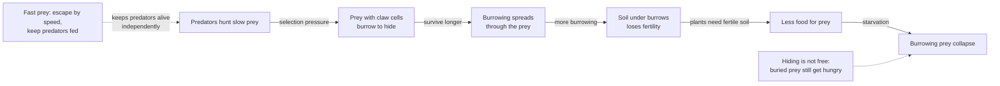
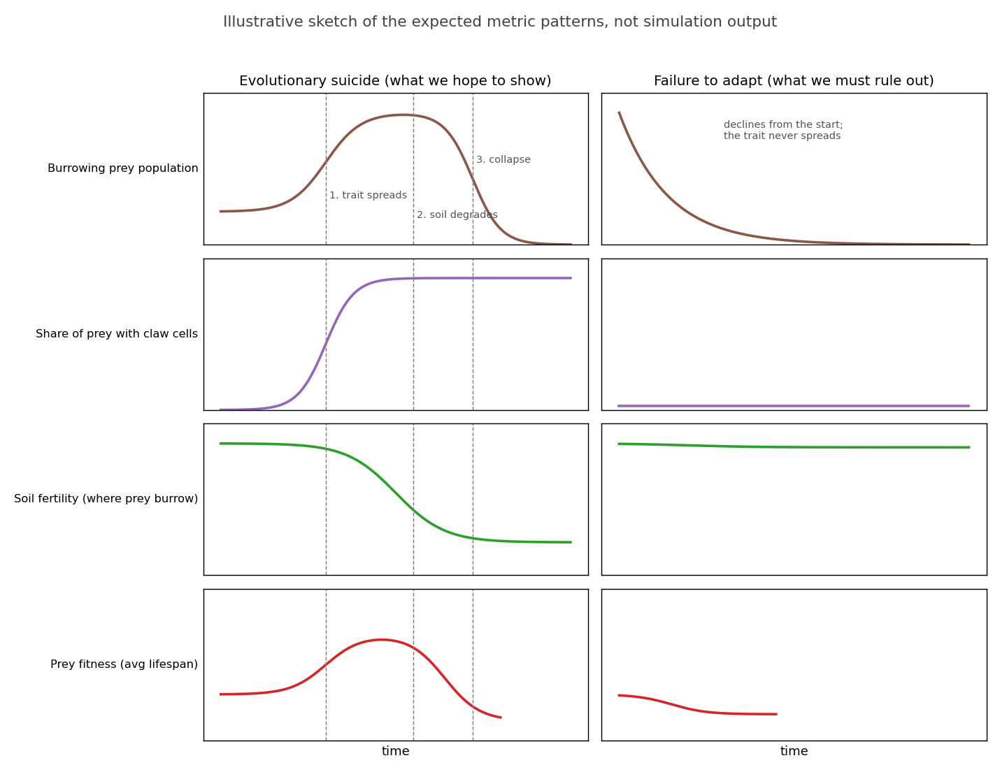
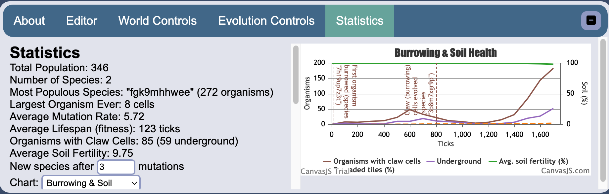
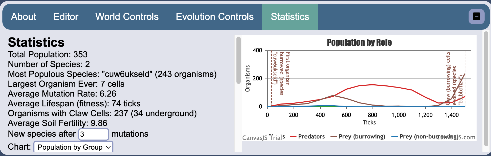
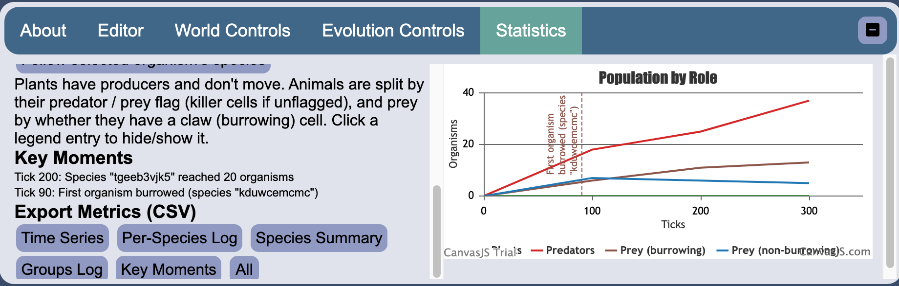
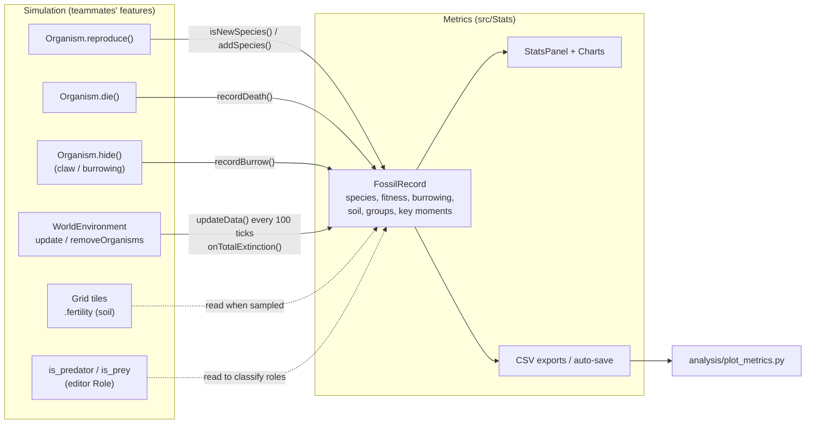

# Metrics & Tracking: Evolutionary Suicide in the Life Engine

This is the reference for the metrics part of our CSC4044Z Artificial Life project (2026). It explains the project
and the team's evolutionary suicide idea, what each metric measures, why it was chosen, how to use it, and how it
connects to the features the rest of the team built. It replaces the project brief and week 3 PDFs as the
written record for this part of the code.

- **Team:** Jenna Rigby, Tarique Mackay, Joshua Diegaardt, Nikita Martin
- **Metrics author:** Joshua Diegaardt

## Contents

1. [The project](#1-the-project)
2. [What we observed before coding](#2-what-we-observed-before-coding)
3. [The team's evolutionary suicide idea](#3-the-teams-evolutionary-suicide-idea)
4. [Why these metrics](#4-why-these-metrics)
5. [Quick start: using the metrics](#5-quick-start-using-the-metrics)
6. [Metric reference](#6-metric-reference)
7. [Exports, memory and long runs](#7-exports-memory-and-long-runs)
8. [Offline plots (Python)](#8-offline-plots-python)
9. [How the metrics interact with the other features](#9-how-the-metrics-interact-with-the-other-features)
10. [Files changed](#10-files-changed)
11. [Limitations and open items](#11-limitations-and-open-items)

---

## 1. The project

The brief, *"Reproducing Evolutionary Suicide"*, asks each group of four to act as naturalists studying a digital
ecosystem in the Life Engine. We seed it with life, watch it evolve over many generations, and document what
happens.

**Central question:** when a species goes extinct, was it **evolutionary suicide** or **failure to adapt**?

| | Failure to adapt | Evolutionary suicide (mis-adaptation) |
|---|---|---|
| What happens | The species lacks the traits to cope with its environment or competitors, and collapses quickly | The species adapts successfully, possibly becoming dominant, but the very trait behind its success destroys the conditions it depends on |
| Example | A heavily armoured species with no mobility goes extinct almost immediately | A predator becomes so good at catching prey that it wipes out its own food supply |

The brief says the second case is the more interesting and harder one to demonstrate, and that our strongest
evidence should focus on it.

**Rules from the brief that shape the code**
- Every run is seeded with at least 1 animal (a mouth and no producer) and at least 2 distinct plants (a producer and no movement).
- Each group member implements at least one identifiable modification, and the modifications must connect to each other.
- Keep changes to cell and environment files. Don't modify other parts of the engine unless strictly necessary.
- **No extinction or survival outcome may be hard-coded.** The code is inspected to confirm extinctions are emergent.
- **What counts as a species:** two individuals are separate species once they differ by roughly **3 or more
  mutations**. Individuals closer than that are siblings or children of the same species.
- **Run length:** at least about 36,000 ticks per trial (10 min at 60 fps) before drawing conclusions about a
  species' trajectory.
- **Monitoring:** the simulation restarts automatically after total extinction, and there is "sparse existing data
  tracking", so collapses can be missed if nobody is watching.

**Timeline and marks:** week 1 is learning and species choice, weeks 2–4 are searching for extinction, weeks 4–5
are coding, and week 6 is a 15-minute presentation. Marks: presentation 40%, weekly observations 20%, codebase 40%.

The brief lists "metrics tracking features to better assess species and environmental conditions/adaptation" as a
suggested modification. This part of the project builds that, aimed specifically at the evidence needed to tell
evolutionary suicide apart from failure to adapt.

## 2. What we observed before coding

In week 3 the team ran the hand-designed species against each other: four animals (Zorg, Ringo, Poena, Impetus
Vorax) and two plants (Flower, Vine). Findings:

- **Ringo drove the collapses.** With Ringo removed, the system settled with the flower and Impetus Vorax
  surviving. With Ringo in, runs usually ended in total extinction.
- **The flower:** Ringo's brain targets armour cells, so it could exploit the flower's defences, deplete it, and then
  starve. We identified this as **evolutionary suicide**: a trait gives an immediate advantage but destroys the
  resource the species needs.
- **The vine:** it usually died because it couldn't evolve defences fast enough against fast predators, which is
  closer to **failure to adapt**. Against slow animals, it sometimes evolved killer cells and then overfilled its
  space.
- **Lesson for metrics:** the difference between the two cases only shows up over time. Who rose first, what
  spread, what ran out, and who crashed after. In week 3 none of this could be measured, only watched.

## 3. The team's evolutionary suicide idea

The plan is to build an ecosystem where an **adaptive trait that is genuinely beneficial in the short term
destroys the species' own resource base**, and where that outcome emerges rather than being scripted.

### The mechanism



- **Predators** chase prey. A slow prey species can't outrun them, so a way to escape is strongly selected for.
- **Burrowing** (the claw cell) lets prey hide underground. While hidden they can't be killed, but they keep
  ageing and getting hungry, so they must resurface.
- **Soil fertility:** burrowing damages the soil. Plants need fertile soil to grow, so the more a population burrows,
  the less food there is. Damage scales with how much the population burrows, so there is a gradual tipping point
  rather than an instant crash.
- **Fast prey** escape by speed alone and don't interact with soil, so predators keep a food source when the slow
  prey collapse. Any predator decline then isn't just a side effect of the burrowers.
- **A plain baseline prey** with no special traits acts as a control: an unaffected comparison while the soil and
  burrowing dynamics play out.

The intended arc for the burrowing prey within one run is **vulnerable → protected → self-destructive**.

### Who builds what

| Member | Feature | Current implementation |
|---|---|---|
| Tarique | Burrowing trait (claw cell) and the slow prey it emerges in | Claw cell and `hide()` implemented. Prey with a claw hide when they see a predator, for `hideDuration` ticks (default 100), removing `hideFertilityCost` (10) fertility from each tile under them |
| Nikita | Soil fertility: a soil health property producers need; damage and recovery | Grid tiles have fertility 0–`maxFertility` (10), regenerating slowly on empty tiles. **Producers and food drops don't read fertility yet**, so soil damage has no effect on food so far |
| Jenna | Predator and fast prey; balancing them | Predator / prey flags with a *Role* dropdown in the editor. Predators kill only prey (killer cells reach 2 tiles) and gain food from kills. Hidden prey can't be killed |
| Joshua | Metrics: populations, soil health, key moments, fitness; baseline prey (control) | **This document.** The baseline prey is an organism design made in the editor, not code |

The current starting setup (`OriginOfLife` → `RandomOrganismGenerator.generatePredatorPrey`) places 10 groups of
predator + prey + claw prey, with food dropping randomly.

## 4. Why these metrics

To claim evolutionary suicide, the presentation needs to show this sequence:

1. The trait **spreads** because it helps, which makes it an adaptation and not bad luck.
2. While it spreads, the species **does better**: higher population and/or longer lives.
3. The trait **damages the resource** (soil, and therefore food).
4. The species then **declines and collapses**, and this happens **after** the resource is damaged.
5. A **control** (fast prey / baseline prey) without the trait doesn't follow the same arc, so the collapse isn't
   caused by something else, such as predators overwhelming every prey.

Failure to adapt looks different: the species declines from the start and the trait never spreads.



*For interpretation only. This is a hand-drawn sketch of what **could** happen, not output from the simulator, and
real runs will look noisier and different. What matters is the order of events shown by the dashed lines.*

Each metric answers part of that sequence:

| Question | Metric | Why this one |
|---|---|---|
| Is the trait present, and spreading? | Organisms with claw cells; *Population by Role* (burrowing vs non-burrowing prey); `claw_evolved` key moment | The trait must spread for it to be an adaptation. `claw_evolved` separates a claw gained by mutation from one we seeded |
| Is the trait being used? | Underground count; burrows per interval | Having a claw isn't burrowing. Soil is only damaged when organisms actually hide |
| Does it help (short term)? | **Fitness** = average lifespan of organisms that died; population per role / lineage | The team's chosen fitness measure. Lifespan should rise while burrowing protects prey, then fall when they start starving |
| Is the resource being damaged? | Average soil fertility; share of degraded tiles | The causal link between the trait and the collapse |
| Did the collapse come after the damage? | Key moments timeline, drawn on every chart | Order of events is the core of the argument |
| Is it specific to the trait? | Role grouping (burrowing vs non-burrowing prey vs predators); lineage grouping | Compares the trait carriers with the controls in the same run |
| Did a "species" really go extinct? | Species redefined as ≥ 3 cell differences; species summary (lifespan, peak) | Matches the brief's definition. Under the old definition every mutant was a "species", so extinctions meant nothing |
| Can the evidence be kept and presented? | CSV exports, auto-save on extinction, Python plots | Long unattended runs auto-reset and lose everything. Presentation figures need the full run |

## 5. Quick start: using the metrics

**Run the simulator**
```
npm install          # once
npm run build        # after any code change (or: npm run build-watch)
python3 -m http.server --directory dist
```
Then open http://localhost:8000/. Use `python3` on macOS; `python` may not exist.

**In the app**

1. **Name your seeded species** so the charts are readable. Use the *Select* tool to click an organism, then in the
   *Editor* tab rename its species (e.g. "Claw prey", "Predator"). Identical seeded copies share one species, so
   each starting design only needs renaming once. Everything that evolves from it keeps that name as its
   *lineage*.
2. Open the **Statistics** tab. The left column scrolls.
3. Pick a chart:

   | Chart | Shows |
   |---|---|
   | Population | total population |
   | Species | number of species (new definition) |
   | Organism Structure | average cells of each type per organism, including claw |
   | Mutation Rate | average mutation rate |
   | Fitness (Lifespan) | average lifespan of organisms that died, overall and per-species average, plus average species age |
   | Burrowing & Soil | organisms with claw cells, underground, soil fertility %, degraded tiles % |
   | Population by Group | population per lineage, role, or followed species |
   | Fitness by Group | fitness per lineage, role, or followed species |

4. For the *by Group* charts, choose **Group by**: *Lineage*, *Role*, or *Followed species + descendants*. To
   follow a species, select an organism in the world and press *Follow selected organism's species*.
5. **Filter:** click a legend entry to hide or show a line. *Show all* resets.
6. **Key moments** are listed newest first, and world-level ones are drawn as dashed lines on every chart.
7. **Export** CSVs with the buttons, or tick **Auto-save logs to Downloads** before a long run (see
   [section 7](#7-exports-memory-and-long-runs)).

The screenshots below are only there to show **where things are** in the Statistics tab and what the charts look
like. Each one comes from a single short run, so the numbers and curves are not representative. Treat them as
illustrations of the interface, not results.



*Interface illustration: the Burrowing & Soil chart. Brown is organisms with claw cells, purple is underground,
green is average soil fertility (%).*



*Interface illustration: Population by Role, with one line each for predators, burrowing prey and non-burrowing prey.*



*Interface illustration: the lower part of the Statistics column, with the grouping note, key moments list and
export buttons.*

**Suggested experiment workflow**
1. Set up the world, name the seeded species, and tick *Auto-save logs*.
2. Run for at least 36,000 ticks, or until extinction.
3. Watch the key moments: claw cells evolved, notable species established or extinct, last claw organism gone,
   total extinction.
4. Export **All**, then run the Python script on the folder for presentation figures.
5. Repeat with controls, e.g. no claw prey, or claw prey with `hideFertilityCost` = 0. Comparing these is what
   separates the effect of the trait from the environment.

## 6. Metric reference

### 6.1 Species definition

**Before:** every offspring with any mutation became a new species, giving thousands of "species" that were really
siblings.

**Now** (brief section 3.3): each species remembers its **founder's** body plan. A mutated child stays in its
parent's species unless its body differs from the founder by at least `species_threshold` cells (default **3**).
When it does, the child founds a new species whose ancestor is the parent species.

- **Distance** is the number of grid positions that differ between the founder and the child. A cell that was added,
  removed or changed type counts as 1. Reversing a mutation brings the distance back down.
- Only the body plan counts. Brain and move-range mutations don't create species.
- Members of a species can differ from each other by up to 2×(threshold−1) cells. This is the usual "distance to a
  representative" approach, as in NEAT.
- Mutations can add mirrored copies of a cell (symmetry), so one birth can pass the threshold in a
  single step. That's intended: the threshold counts cells that differ, not mutation events.
- **Identical seeded organisms share one species.** `OriginOfLife` places 10 copies of each design. A root
  organism joins an existing root species if its body is identical and its predator / prey flag matches, giving 3
  starting species instead of 30.
- The threshold can be changed in the Statistics tab ("New species after N mutations"). It applies to new births and
  is saved with the world.

Code: `Species.mutationDistance()`, `Species.isSameFounder()`, `FossilRecord.isNewSpecies()`, `FossilRecord.addSpecies()`.

### 6.2 Fitness

The team defines fitness as the **lifespan of each species**. It is implemented as **how many ticks organisms of a
species live before they die**.

- Every death records the organism's `lifetime` against its species.
- **Interval fitness** (charted): average lifetime of organisms that died in each 100-tick sample.
  - `fitness_all`: over every organism that died, so large species weigh more.
  - `fitness_species`: each species' own average, then averaged across species with equal weight.
  - Per species, lineage and role, it's in the logs and *Fitness by Group*.
- **Lifetime fitness** per species: average over the species' whole history (species summary CSV).
- **Species age:** how long a species has existed. This is the other reading of "lifespan of a species". It only
  grows while the species is alive, so it can't show a rise-then-crash, but it's useful alongside fitness.

**Expected suicide signature:** a burrowing prey's fitness **rises** (it escapes predators), then **falls** (it starves
once soil damage removes its food), then the species collapses.

**Caveats**
- Maximum lifetime is `cells × lifespanMultiplier` (100). Bigger organisms can live longer, and predators often sit
  at this cap (~600 ticks) because they die of old age. **Prey** fitness is the line that reflects predation and
  starvation.
- Deaths from the kill / clear tools are recorded too. Avoid using them during measured runs.
- Deaths of a species that goes extinct mid-interval still count, so the final crash is captured.

### 6.3 Burrowing (claw cell)

| Metric | Meaning | Where |
|---|---|---|
| Organisms with claw cells | trait present: can burrow | `burrowers`, `burrower_frac`; Burrowing & Soil chart; `avg_claw` in Organism Structure |
| Evolved claw organisms | claw cells in a lineage whose root had none, i.e. gained by mutation rather than seeded | `evolved_claw` (CSV) |
| Underground | hidden at the moment of sampling | `hidden`; Burrowing & Soil chart |
| Burrows | `hide()` calls in each 100-tick interval (behaviour) | `burrows` (CSV only), also per species, lineage and role |

- Each species stores `seeded_claw`, inherited by its descendants. It is true if the lineage started with claw cells,
  either seeded or dropped in from the editor with one.
- With the default `hideDuration` = 100, which equals the sample interval, *underground* and *burrows* come out
  almost identical. So only *underground* is charted. They diverge if `hideDuration` changes.
- Cell composition averages are taken over **every living organism**, not species founders, because members drift
  from their founder.

### 6.4 Soil health

Each grid tile has `fertility` from 0 to `Hyperparams.maxFertility` (10). Burrowing lowers it, and empty tiles
regenerate it slowly. Each sample records:
- `soil_mean`: average fertility over all tiles. Charted as % of `maxFertility`.
- `soil_degraded_frac`: share of tiles below 50% of the **starting** average. Charted as %.

### 6.5 Roles and lineages

- **Role** is decided per organism when sampled (population) and when it dies (fitness):
  - *Plants*: producer, doesn't move.
  - *Predators*: `is_predator` flag (or, if unflagged, an animal with a killer cell).
  - *Prey (burrowing)*: has a claw cell.
  - *Prey (non-burrowing)*: everything else.
- **Lineage:** every species stores the name of the root species it descends from (a starting design or an
  editor-dropped organism). Renaming a root renames its lineage everywhere.
- **Followed species:** a species, all its descendant species combined, and the total. Built from the per-species
  log, so it works back in time. After a log part has been flushed (see [section 7](#7-exports-memory-and-long-runs)),
  it only covers ticks since then.
- Group fitness is the deaths-weighted average lifetime. Groups also record burrows.

Code: `FossilRecord.classifyRole()`, `FossilRecord.calcGroups()`, `Charts/GroupChart.js`.

### 6.6 Key moments

| Type | Trigger | Drawn on charts |
|---|---|---|
| `burrow_first` | first time any organism hides (exact tick; names the species) | yes |
| `claw_evolved` | first claw cells in a lineage that started without them (names the species). Seeded claws don't trigger it | yes |
| `burrow_end` | the last organism with claw cells is gone | yes |
| `soil_25`, `soil_50`, `soil_75` | average fertility falls by that % from the start | yes |
| `species_established` | a species reaches 20 organisms | listed only |
| `species_extinct` | a species that once had ≥ 20 organisms goes extinct (logs peak and lifespan) | listed only |
| `total_extinction` | every organism has died | yes |
| `log_full` | per-species / groups log hit its cap with auto-save off | listed only |

Species-level events are listed rather than drawn, to keep the charts readable.

## 7. Exports, memory and long runs

Statistics tab → **Export Metrics (CSV)**. Files are only written when you click an export button, or when
**Auto-save logs to Downloads** is on. Browser pages can't write to a file in the background.

| File | Contents | Rows |
|---|---|---|
| `timeseries_tickN.csv` | per sample: population, species, mutation, avg cells per type, fitness, species age, claw organisms, evolved claw, underground, burrows, soil | 1 per 100 ticks |
| `species_log_tickN.csv` | per species per sample: population, deaths, fitness, age, has_claw, burrows, ancestor, lineage | ≈ living species per 100 ticks |
| `groups_log_tickN.csv` | per lineage / role per sample: population, deaths, fitness, burrows | (lineages + 4) per 100 ticks |
| `species_summary_tickN.csv` | per species (living + extinct with ≥ 10 total members): start/end, peak, lifetime fitness, total burrows, body plan, lineage | 1 per species |
| `key_moments_tickN.csv` | the key moment log | 1 per event |

**Memory.** Charts keep the last 500 samples (50,000 ticks) and drop older points. The export logs are small: a
36,000-tick run is a few thousand rows. The real risk was the per-species log silently stopping at its cap, which
is now handled:
- **Auto-save on:**
  - When the per-species or groups log reaches 100,000 rows, both download as `..._partK_...csv` and are cleared
    from memory, so memory use stays flat.
  - All CSVs also download when everything goes extinct, before the auto-reset wipes the record.
  - The browser may ask once to allow multiple downloads.
- **Auto-save off:** logging pauses at the cap and a `log_full` key moment appears. Turning auto-save on resumes it.

Logs are also saved with the world file (*Save World*), and older saves still load.

## 8. Offline plots (Python)

`analysis/plot_metrics.py` turns a folder of exported CSVs (including numbered parts) into presentation figures.

```
pip install matplotlib
python3 analysis/plot_metrics.py <folder of CSVs> --out plots [--smooth 5] [--top 8] [--follow "Claw prey"]
```

| Output | Contents |
|---|---|
| `groups_lineage.png`, `groups_role.png` | population (top) and smoothed fitness (bottom) per group, with key moments |
| `stacked_lineage.png`, `stacked_role.png` | stacked population share over time (Muller-style) |
| `burrow_soil.png` | claw organisms, underground, prey / predator populations; soil (% of start, % degraded) on a second axis |
| `followed_<name>.png` | one species and its descendants (`--follow`) |

## 9. How the metrics interact with the other features

The metrics **observe**; they never decide what happens to an organism. Nothing in the simulation reads species,
lineage or role, so no survival or extinction outcome depends on this code (brief section 3.2). The only
engine-side change is which species an organism is *labelled* as.



| Feature | Owner | How the metrics use it | Hook |
|---|---|---|---|
| Reproduction / mutation | engine | decides whether a mutated child is a new species (≥ 3 cells from founder) | 1 line in `Organism.reproduce()` |
| Death | engine | records lifetime → fitness, per species and role | 1 line in `Organism.die()` |
| Burrowing (claw, `hide()`) | Tarique | counts burrows; logs the first burrow; reads `isHidden()` and `has_claw` | 1 line in `Organism.hide()` |
| Soil fertility | Nikita | reads `cell.fertility` on every tile each sample | none (read-only) |
| Predator / prey flags | Jenna | classifies roles; flags also separate identical bodies into different seeded species | none (read-only) |
| Starting setup (`OriginOfLife`) | Tarique / Jenna | identical seeded copies are merged into one species | inside `FossilRecord.addSpecies()` |
| World update / reset | engine | samples every 100 ticks; final sample + auto-save before auto-reset | 1 line in `WorldEnvironment.removeOrganisms()` |
| Organism editor | engine | *Follow* uses the selected organism's species; editor names become lineage names | `ControlPanel` passes the editor to `StatsPanel` |

**When teammates change their features:**
- If the soil property is renamed or its scale changes, update `calcSoil()` in `FossilRecord.js` and
  `BurrowSoilChart.js` (which uses `Hyperparams.maxFertility`).
- If the burrow cell changes, update `BURROW_CELL` in `FossilRecord.js` (currently `CellStates.claw.name`).
- If roles change (e.g. a separate fast-prey flag), update `classifyRole()` and `ROLES`.

## 10. Files changed

| File | Change |
|---|---|
| `src/Stats/Species.js` | founder signature, `mutationDistance`, death / lifetime / burrow tracking, peak population, lineage, `seeded_claw`, `isSameFounder` |
| `src/Stats/FossilRecord.js` | species threshold, fitness / burrowing / soil sampling, lineage and role groups, key moments, extinct-species summaries, CSV export, log flushing, extinction hook |
| `src/Stats/StatsPanel.js` | stats lines, threshold input, grouping / follow controls, key moments list, export buttons, auto-save |
| `src/Stats/Charts/FitnessChart.js` (new) | fitness chart |
| `src/Stats/Charts/BurrowSoilChart.js` (new) | burrowing and soil chart |
| `src/Stats/Charts/GroupChart.js` (new) | population / fitness by lineage, role or followed species |
| `src/Stats/Charts/ChartController.js` | key-moment markers on all charts |
| `src/Stats/Charts/CellsChart.js` | series matched by name (claw included), averages over all organisms |
| `src/Organism/Organism.js` | 3 one-line hooks: `reproduce`, `die`, `hide` |
| `src/Environments/WorldEnvironment.js` | 1 line: `FossilRecord.onTotalExtinction()` |
| `src/Controllers/ControlPanel.js` | passes the organism editor to the stats panel |
| `dist/index.html`, `dist/css/style.css` | Statistics tab UI |
| `analysis/plot_metrics.py` (new) | offline plots |
| `docs/metrics/` (new) | images used in this document |

## 11. Limitations and open items

- **Soil doesn't affect food yet** (Nikita's mechanic is in progress). The soil metrics measure damage correctly, but
  until producers and food drops depend on fertility, burrowing can't cause starvation, so the suicide loop isn't
  closed.
- **Soil key moments use the whole-grid average.** Burrowing damage is local, so the average barely moves and
  `soil_25/50/75` may never fire. Revisit once soil affects food: base them on the share
  of degraded tiles, or on fertility near prey.
- **`burrow_first` fires early in every run.** Seeded claw prey hide as soon as they see a predator. Candidates to
  replace it: "burrowing became widespread" (claw organisms above a share of prey) and "burrowing peaked".
- **Hiding is a fixed rule, not evolved.** Any prey with a claw hides on seeing a predator (`Brain.js`), so the
  trait being selected is the claw cell itself, not the decision to use it.
- **Fitness is capped by body size**, so compare prey with prey and use the role / lineage views.
- **Baseline prey (control)** still needs to be designed in the editor and saved as an organism `.json`.
- **Random species names:** seeded species get random names until you rename them (see the
  [quick start](#5-quick-start-using-the-metrics)).
